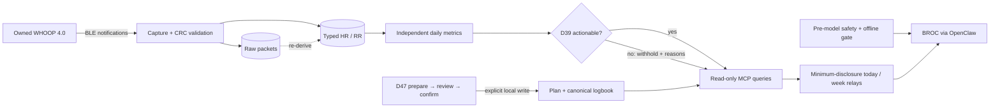

# Doop: method and evidence

Doop is a local-first engineering case study and experimental reference
implementation built from an independently validated and extended
reverse-engineered WHOOP 4.0 BLE pipeline. The source shows raw-first packet
capture, HR/RR decoding, RTC-aware buffered-history recovery, independent proxy
metrics, confidence-gated MCP tools, confirmed workout/plan boundaries, and
BROC's minimum-disclosure safety-gated agent path.

View the evidence-first project overview at
[doop-showcase.vercel.app](https://doop-showcase.vercel.app).

This is not a turnkey or production health product. The narrow, owner-controlled
Gen4 workflow is documented in [Using this code](USING_THIS_CODE.md), including
configuration, hardware cautions, supported boundaries, and a no-hardware smoke
path. The repository contains no owner database, exports, captured health
packets, device identifiers, credentials, personal athlete profile, or private
Git history. Test packets, plans, preferences, and health inputs are synthetic.

Start with the [reverse-engineering case study](CASE_STUDY.md). Its
[one-page static trace](evidence/STATIC_TRACE.md) follows a generated packet
through parsing, daily computation, MCP JSON, and BROC's visible answer. The
[hardware results ledger](evidence/HARDWARE_RESULTS.md) separates recorded
owned-device evidence from checks reproducible in this data-free repository.

If you have ten minutes, use the
[claim → evidence → command checklist](REVIEWER_CHECKLIST.md). It points each
headline claim to one file and one focused verification command.

The [evidence manifest](EVIDENCE_MANIFEST.md) is the release index: it ties
headline claims and résumé language to the corresponding evidence and checks.

## Architecture



Capture preserves evidence before interpretation. Compute retains audit values;
D39 decides whether they may influence coaching. The accepted agent sees two
preformatted relays, while safety/offline handling occurs before model
inference. Canonical writes remain outside MCP behind explicit local review.

## What this does and does not claim

- It demonstrates empirical protocol investigation, negative results,
  raw-first storage, replay-safe decoding, and testable domain-agent controls.
- Recovery, strain, and sleep are independent proxies. They are not WHOOP
  parity, medical outputs, or ground truth.
- OpenClaw supplies generic agent runtime and Telegram transport. Doop supplies
  the domain data model, bounded tools, confidence/confirmation policy,
  minimum-disclosure relays, deterministic safety handling, and evaluator.
- The protocol work extends cited prior art and independently verifies the
  shipped wire facts; it was not invented from nothing.

## Verify the evidence

Requires Python 3.11+ and [uv](https://docs.astral.sh/uv/).

```sh
uv sync --all-extras --locked
python3 tools/privacy_check.py
uv run pytest -q
node --test integrations/openclaw/plugins/doop-safety-gate/test/*.test.js
```

The sanitized suite contains Python and OpenClaw safety-plugin tests that run
without a database, band, credentials, or private runtime. Exact release-gate
counts are recorded in `RELEASE_NOTES.md` after the final clean-clone run.

For demonstration-video recording only, create the isolated minimal seed. It
refuses to overwrite an existing file, stores synthetic raw packets, and
computes derived metrics through the production path:

```sh
uv run python -m tools.create_film_seed \
  --output tmp/film-seed.db --film-date 2037-07-06
```

Focused entry points:

- `src/whoop_local/capture/proprietary_protocol.py` and
  `tests/test_proprietary_protocol.py`: framing, CRCs, HR/RR and four-slot RR
  behavior;
- `src/whoop_local/capture/history_sync.py` and `tests/test_history_sync.py`:
  RTC-first, commit-before-ACK, replay-safe history recovery;
- `src/whoop_local/compute/` and `tests/test_metrics.py`: independent metrics;
- `src/whoop_local/mcp_server/queries.py` and
  `tests/test_training_insights.py`: D39 confidence gates and minimized relays;
- `src/whoop_local/integrations/openclaw_acceptance.py` and the OpenClaw safety
  plugin tests: strict outputs, offline refusal, and pre-model safety handling.

The sanitized [agent acceptance record](integrations/openclaw/ACCEPTANCE.md)
publishes the scenario matrix, visible outputs, and both promotion revocations.
The separate [D47 confirmation record](evidence/D47_CONFIRMATION.md) shows why
draft preparation and review cannot silently become a logged workout.

The [demonstration storyboard](VIDEO_STORYBOARD.md) defines the four required
agent beats, exact narration, Mac recording setup, and frame-by-frame privacy
review for the v1.0 video.

## Privacy and licensing

`tools/privacy_check.py` checks the working tree and every reachable Git blob,
path, commit identity/message, and annotated-tag identity/message for generic
private-artifact, PII-shape, captured-frame, and secret patterns. It reports
only safe identifiers and categories, never matched content. Third-party
contributions and their status are recorded in `THIRD_PARTY_NOTICES.md`. The
project is released under Apache-2.0; see `LICENSE`.

Release evidence and traceable résumé language are recorded in
`EVIDENCE_MANIFEST.md`, `RELEASE_NOTES.md`, and `RESUME_BULLETS.md`.
